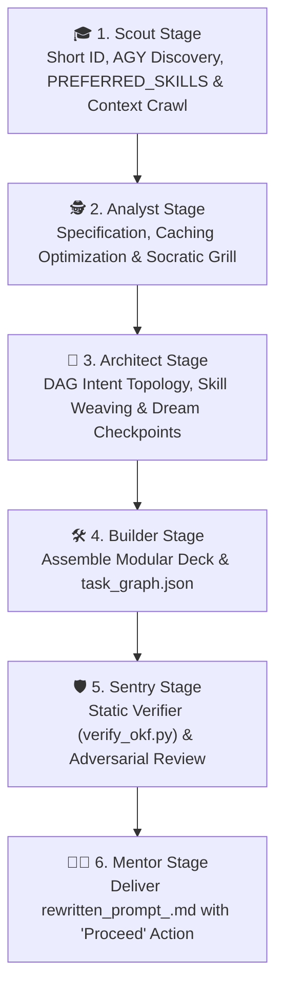

> [!IMPORTANT]
> **DISCLAIMER & LIABILITY NOTICE**: This is a **personal, individual project** created and maintained entirely by the author (Prashanth). It is **not** an official Google product, it is **not** affiliated with or supported by Google Cloud or Google LLC, and it does **not** come with any official support or warranty. By using this software, you acknowledge that you are solely liable for its use.

# ✍️ Prompt-Writer: Meta-Orchestration & Task Graph Engine

[](https://skills.sh)
[](https://antigravity.google)


An advanced, meta-level custom skill designed for **Google Antigravity** and **Claude Code** that programmatically transforms vague, incomplete, or complex user requests into highly-structured, technically rigorous **Modular Orchestration Decks** (`task_graph.json`, `orchestrator.md`, `tasks/*.md`) and Open Knowledge Format (OKF) bundles.

---

## 🧭 Architecture Principles

### 1. Pure Meta-Orchestrator (Zero Practice Redefinition)
`prompt-writer` does **not** invent bespoke rules for specifications, testing, security, or documentation. Instead, it systematically **composes, delegates to, and weaves** the 16 authoritative global skills into the generated prompt deck:
- **Specification & Interface Contracts** ➔ Delegated to [`spec`](file:///Users/ksprashanth/code/github/agent-skills/skills/spec) and [`source-driven-development`](file:///Users/ksprashanth/code/github/agent-skills/skills/source-driven-development)
- **Knowledge Bundles & Concept Docs** ➔ Delegated to [`knowledge-catalog`](file:///Users/ksprashanth/code/github/skills-knowledge-catalog/skills/knowledge-catalog)
- **Task Decomposition & Dependency DAGs** ➔ Delegated to [`planning`](file:///Users/ksprashanth/code/github/agent-skills/skills/planning)
- **Verification & TDD Loops** ➔ Delegated to [`test`](file:///Users/ksprashanth/code/github/agent-skills/skills/test) and [`expectation-harness`](file:///Users/ksprashanth/code/github/skills-expectation-harness/skills/expectation-harness)
- **Adversarial Audits & Security** ➔ Delegated to [`review`](file:///Users/ksprashanth/code/github/agent-skills/skills/review) and [`security-and-hardening`](file:///Users/ksprashanth/code/github/agent-skills/skills/security-and-hardening)
- **Documentation & Presentation Portals** ➔ Delegated to [`documentation`](file:///Users/ksprashanth/code/github/skills-documentation/skills/documentation) and [`compile-docs`](file:///Users/ksprashanth/code/github/skills-prompt-writer/skills/compile-docs)
- **Personal Voice & Copywriting** ➔ Delegated to [`copy-write-bara`](file:///Users/ksprashanth/code/github/copy-write-bara)
- **Visuals & Diagram Assets** ➔ Delegated to [`image-gen-expert`](file:///Users/ksprashanth/code/github/skills-image-gen-expert/skills/image-gen-expert)

### 2. Curated Preferred Skills Matrix vs. Brittle Crawlers
Rather than relying on unguided filesystem crawling, `prompt-writer` consults an authoritative, curated Markdown matrix:
[`skills/prompt-writer/references/PREFERRED_SKILLS.md`](file:///Users/ksprashanth/code/github/skills-prompt-writer/skills/prompt-writer/references/PREFERRED_SKILLS.md)

### 3. Decoupled Cognitive Selection vs. Execution Plumbing
- **LLM Reasoning**: Evaluates project tech stack, reads `PREFERRED_SKILLS.md` (and queries `skills.sh` if needed), and selects the precise skill bundle.
- **Python Plumbing (`skills_bootstrapper.py`)**: A deterministic script that only handles symlink creation into `<project>/.gemini/skills/` and `<project>/.agents/skills/`, or runs `npx skills add`.

### 4. Native Antigravity Grounding
- Prioritizes built-in [`antigravity-guide`](file:///Users/ksprashanth/.gemini/antigravity/builtin/skills/antigravity_guide/SKILL.md) and its offline subdocs to discover native AGY mechanics (`/goal`, `/schedule`, `/browser`, `/grill-me`, `/learn`, artifacts, workspace isolation).
- Uses live URLs (`https://antigravity.google/docs`) strictly as a fallback.
- Standardizes subagents to `Model: "inherit"`.

### 5. Dual-Loop Dream Sequences
- **In-Flight Dream Cycle**: Sentry/Critic subagent audits code at DAG checkpoints, dynamic DAG self-expansion until `STATUS: OPTIMAL / ZERO_GAPS`.
- **Cross-Session Dream Sequence**: Offline log parsing of `<appDataDir>/brain/<id>/transcript.jsonl` into `.gemini/knowledge/` OKF concepts.

---

## 🔄 The 6-Persona Meta-Operational Pipeline



---

## 📁 Repository Structure

```
skills-prompt-writer/
├── skills/
│   ├── prompt-writer/
│   │   ├── SKILL.md                          # Core Prompt-Writer instructions
│   │   ├── references/
│   │   │   ├── PREFERRED_SKILLS.md           # Authoritative Curated Skills Catalog
│   │   │   ├── dag_orchestration.md          # DAG schema and Pure Manager Protocol
│   │   │   ├── dream_sequence.md             # In-flight & cross-session Dream Sequence spec
│   │   │   ├── template.md                   # XML / Markdown prompt envelope schema
│   │   │   └── dag_templates/                # Templates for coding, ui_design, security, etc.
│   │   ├── scripts/
│   │   │   └── skills_bootstrapper.py        # Deterministic project-scoped skill bootstrapper
│   │   └── examples/
│   │       └── example.md                    # Before-and-after prompt transformations
│   ├── compile-docs/
│   │   └── SKILL.md                          # Standalone HTML documentation compiler skill
│   └── validate-skill/
│       └── SKILL.md                          # Skill validation and linting rules
├── docs/                                     # Compiled Stitch documentation portal
│   ├── architecture_map.md                   # Visual architecture and sequence maps
│   ├── master_roadmap.md                     # SDLC roadmap and milestone tracking
│   └── user_guide.md                         # Detailed usage workflows
├── scripts/
│   ├── prompt_registry.py                    # Central prompt registry CLI
│   ├── execute_pipeline.py                   # Multi-prompt pipeline runner
│   └── validate_skill.sh                     # Automated validation test script
└── README.md
```

---

## 🛠️ Quick Start & Usage

### 1. Invoke via Slash Command
Inside Antigravity 2.0 or Claude Code:
```text
/prompt-writer Build a multi-agent customer support agent with ADK deployed to Cloud Run
```

### 2. Socratic Interview
The Prompt-Writer asks focused, 1-at-a-time questions to confirm:
- Target cloud services and database backends
- UI theme preferences (for web/doc tasks)
- Project-scoped skill bundles (`google-agents-cli-workflow`, `cloud-run-basics`, etc.)

### 3. Execution via Pure Manager
The resulting `rewritten_prompt_<SHORT_ID>.md` presents the complete DAG architecture with a **Proceed** action. When triggered, the Manager thread:
1. Bootstraps on-demand skills into `<project>/.gemini/skills/`
2. Dispatches subagents node-by-node via `/goal`
3. Enforces verification gates and in-flight Dream Retrospectives until `ZERO_GAPS`

---

## 📜 License

This project is licensed under the MIT License. See [LICENSE](LICENSE) for details.
