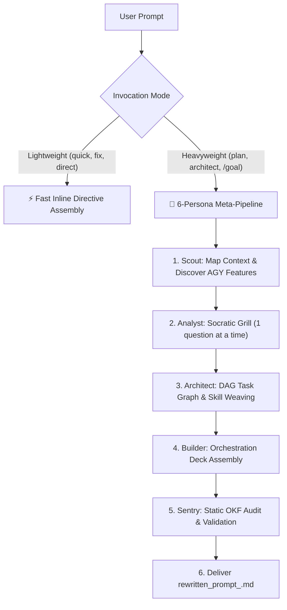

# ✍️ Prompt-Writer User Guide: Architecture & Runbook

This guide covers how to use the **Prompt-Writer** custom skill in Google Antigravity and Claude Code to transform user prompts into mathematically structured, intent-driven **Modular Orchestration Decks** (`task_graph.json`, `orchestrator.md`, `tasks/*.md`) and Open Knowledge Format (OKF) bundles.

---

## 🧭 1. Architectural Foundation: Pure Meta-Orchestration

The `prompt-writer` operates as a **Pure Meta-Orchestrator**. It adheres to the **Zero Practice Redefinition** rule:
- It does not define its own private standards for writing tests, specifications, or docs.
- Instead, it systematically **composes, delegates to, and weaves** the 16 authoritative global lifecycle skills:

<style>
th:first-child, td:first-child {
    white-space: nowrap;
}
td:first-child code {
    white-space: nowrap !important;
    word-break: normal !important;
}
</style>

| Global Skill | Meta-Orchestration Delegation |
| :--- | :--- |
| **`spec`** | Formal specifications, interface boundaries, and contract definitions |
| **`knowledge-catalog`** | Open Knowledge Format (OKF) bundle scaffolding at `.gemini/knowledge/<SHORT_ID>/` |
| **`planning`** | Atomic task decomposition and strict dependency DAG ordering |
| **`test`** | Test-Driven Development (TDD/BDD) prove-it verification loops |
| **`review`** | 5-axis code quality, architecture, security, and performance reviews |
| **`source-driven-development`**| Citing official documentation and verifying API signatures |
| **`documentation`** | Unified documentation and lifecycle archiving |
| **`compile-docs`** | Compiling Markdown into interactive single-page HTML presentations |
| **`expectation-harness`** | Static verifiers and blinded LLM judge rubrics |
| **`using-agent-skills`** | Meta-discovery of specialized domain skills |
| **`copy-write-bara`** | Signature casual, friendly, and technically deep copywriting persona |
| **`image-gen-expert`** | Gemini Flash Image & Imagen multimodal asset generation |
| **`codelab-creator`** | Interactive developer tutorial structuring |
| **`make-google-oss`** | Open source licensing and compliance verification |
| **`skill-sync`** | Symlink synchronization across `~/.agents`, `~/.gemini`, `~/.claude` |

---

## 🚀 2. Invocation Modes & CLI Workflows



### A. Invoking in Antigravity Chat
Type `/prompt-writer` followed by your task:
```text
/prompt-writer Build a production-grade Cloud Run microservice in Go with OpenTelemetry and Cloud Spanner
```

### B. Lightweight vs. Heavyweight Mode
- **Lightweight Mode** (`--light`, `quick`, `fix`): Skips Socratic grilling and subagent indexing for localized single-file fixes.
- **Heavyweight Mode** (`--heavy`, `plan`, `architect`, `/goal`): Executes the full 6-persona pipeline, creating `.gemini/prompts/<SHORT_ID>/` and `.gemini/knowledge/<SHORT_ID>/`.

---

## 💬 3. The Socratic Grill & Propose Loop

When running in heavyweight mode, Prompt-Writer follows strict discipline:
1. **One Question at a Time**: Never dumps a wall of text.
2. **Structured Options (`ask_question`)**: Provides concrete technical choices (e.g. database backends, UI design themes, or project skills).
3. **Proactive Recommendations**: Lists `(Recommended)` first with technical rationale.
4. **OKF Journaling**: Every confirmed decision is written to `.gemini/knowledge/<SHORT_ID>/analyst/user_decisions.md`.

---

## 📦 4. On-Demand Project Skill Bootstrapping

When the LLM selects project-scoped skills from the curated catalog (`PREFERRED_SKILLS.md`) or `skills.sh`, it invokes the bootstrapper plumbing:

```bash
# Bootstrap local canonical skills into the active project workspace:
python3 ~/.agents/skills/prompt-writer/scripts/skills_bootstrapper.py \
  --project ./my-project \
  --skills spec,google-agents-cli-workflow,cloud-run-basics,test,review

# Add a community package from skills.sh:
npx skills add vercel-labs/agent-skills --skill vercel-optimize --project
```

---

## 🌙 5. In-Flight Dream Sequences & Retrospective Verification

During DAG execution, the Manager thread enforces the **Never-Satisfied Orchestration Rule**:
1. At encoded `retrospective_checkpoints`, the Manager launches a Sentry/Critic subagent via `/goal` (`Model: "inherit"`, `Workspace: "share"`).
2. The Critic executes static audits (`verify_okf.py`) and probes for unhandled edge cases.
3. If flaws are found, the Critic returns an evolution proposal, and the Manager dynamically appends child nodes (`task_XX_evolution_1`) to `task_graph.json`.
4. The loop terminates only when the Critic explicitly signs off with:
   ```
   STATUS: OPTIMAL / ZERO_GAPS
   ```

---

## 📄 6. Compiling HTML Documentation Portals

To compile your project documentation into interactive Stitch presentations:

```bash
python3 /Users/ksprashanth/code/github/skills-documentation/skills/documentation/scripts/compile_docs.py --dir ./docs
```

The compiler enforces strict tag symmetry audits and injects the CSS table nowrap reset:
```css
th:first-child, td:first-child {
    white-space: nowrap;
}
td:first-child code {
    white-space: nowrap !important;
    word-break: normal !important;
}
```
