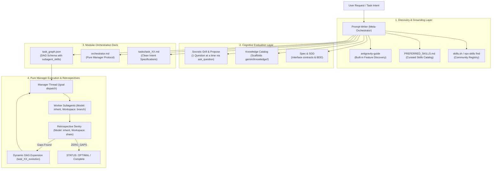
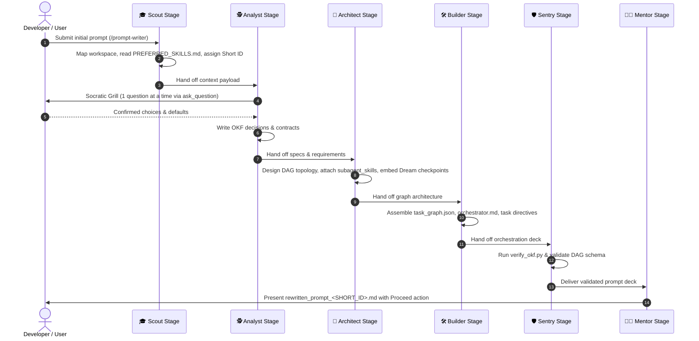
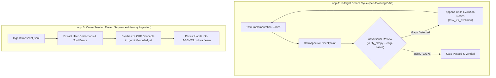

# 🗺️ Prompt-Writer: System Architecture Map

This document details the architectural topology, meta-orchestration flow, and multi-agent coordination mechanics powering the **Prompt-Writer** engine.

---

## 🏛️ 1. Pure Meta-Orchestration Topology



---

## ⚡ 2. The 6-Persona Execution Pipeline



---

## 🌙 3. Dual-Loop Dream Sequence Engine



---

## 📂 4. Open Knowledge Format (OKF) Namespaced Layout

All intelligence gathered during the prompt-writing session is organized into an isolated bundle governed by [`knowledge-catalog`](file:///Users/ksprashanth/code/github/skills-knowledge-catalog/skills/knowledge-catalog):

```
.gemini/knowledge/<SHORT_ID>/
├── index.md                      # Progressive disclosure Table of Contents
├── log.md                        # Chronological session changelog
├── scout/
│   ├── codebase_map.md           # Indexed folder paths, dependencies, route mappings
│   ├── web_intel.md              # Live library versions and release telemetry
│   └── docs_crawler.md           # MCP documentation and API signatures
├── analyst/
│   ├── user_decisions.md         # Codified user preferences, UI styling, and decisions
│   └── bdd_scenarios.md          # Gherkin-style behavior scenarios
├── architecture/
│   └── data_contracts.md         # Pydantic schemas, protobufs, and API models
└── sentry/
    └── secure_threat_model.md    # Discovered threat models and security verification criteria
```
